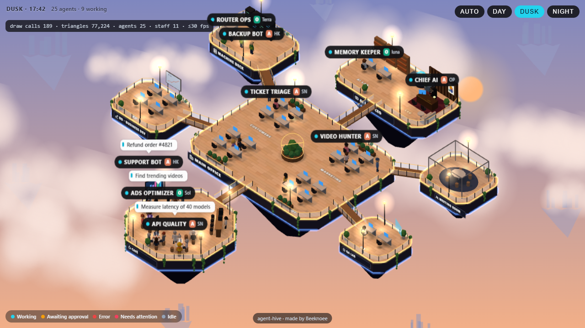
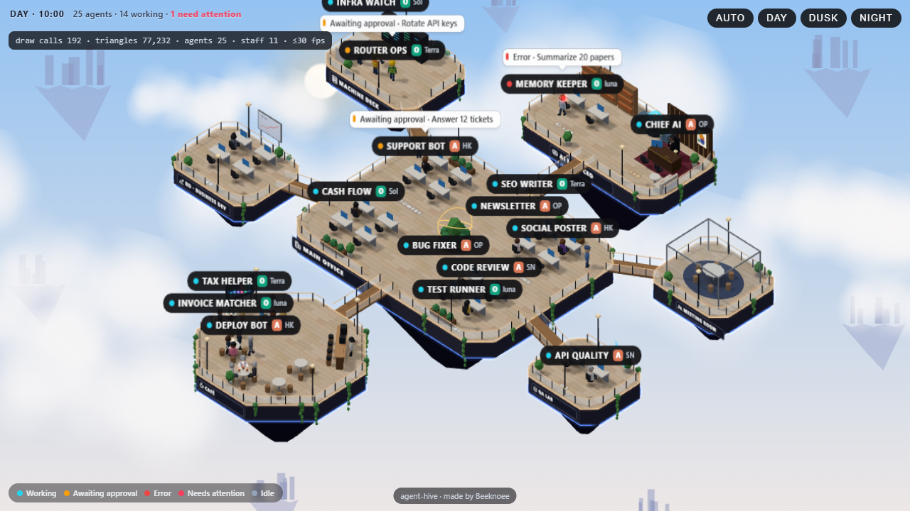
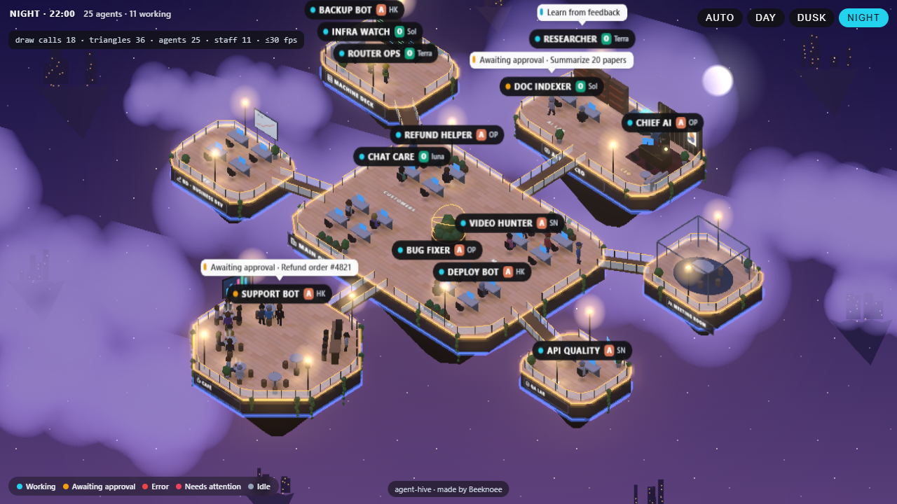

# agent-hive 🐝

**A low-poly 3D office for your AI agent team.** Every agent is a little employee on floating office islands. They sit and type when **running**, walk to the meeting room when **awaiting approval**, hang out at the café when **idle**, and gather around the central planter with a blinking red dot when something **fails or needs a human**. The sky follows the real clock: dawn, day, dusk and night with the lights on.

Built with [Three.js](https://threejs.org). No external 3D models: everything is generated in code. MIT licensed.

Made by **[Beeknoee](https://beeknoee.com)**.



| Day | Night |
|---|---|
|  |  |

**English** · [Tiếng Việt](#tiếng-việt)

---

## Features

- **Status → behaviour.** Give it a snapshot of your agents and they walk to the right place on their own: desk, meeting room, café, or the alert ring around the planter.
- **Readable at a glance.** Name pills with a status dot and a model badge (Haiku → `HK`, Sonnet → `SN`, Opus → `OP`, …). Up to 3 speech bubbles at once, most urgent first. Labels avoid overlapping. Click a person **or their label** to select them.
- **Lively, not noisy.** Optional extra staff: a security guard on patrol, a technician, and a barista who carries steaming coffee to the tables.
- **Light.** At most 30 fps. Pauses when the tab is hidden or the canvas is off-screen. Static scene merged by material (about 66 draw calls). Respects `prefers-reduced-motion`. `dispose()` releases the WebGL context.
- **Optional night bloom** (`quality: 'high'`) for full-screen use. It turns itself off on slow machines.
- **English or Vietnamese UI.** The API has English names; the original Vietnamese names work too.
- **Clean licence.** No third-party 3D assets, fonts or brand logos are bundled.

## Requirements

- `three` ≥ 0.160 (peer dependency)
- A browser with WebGL 2 (current Chrome, Edge, Firefox, Safari)
- React ≥ 18 only if you use the `<AgentHive>` component
- A bundler that understands ES modules (Vite, Next.js, webpack 5, …). The package ships plain ES modules, so there is no build step.

## Install

The package is installed straight from GitHub:

```bash
npm install three github:beeknoee/agent-hive
```

You can pin a tag or commit: `github:beeknoee/agent-hive#v0.1.0`.

## Quick start

```html
<div id="office" style="height: 520px"></div>
```

```js
import { createAgentHive } from 'agent-hive';

const hive = createAgentHive(document.getElementById('office'), {
  language: 'en',
  legend: true,
  onSelect: (id) => console.log('clicked', id),   // null when clicking empty space
});

hive.setAgents([
  { id: 'ceo',   name: 'Chief AI',      role: 'chief',      status: 'running', model: 'claude-opus-5-5' },
  { id: 'ads',   name: 'Ads Optimizer', room: 'marketing',  status: 'running', task: 'Tune ad campaign' },
  { id: 'ops',   name: 'Infra Watch',   room: 'infra',      status: 'error',   task: 'Disk full' },
  { id: 'inbox', name: 'Inbox Bot',     room: 'customers',  status: 'needs_attention', task: '3 messages need a human' },
  { id: 'tax',   name: 'Tax Helper',    room: 'finance',    status: 'idle' },
]);

// Call setAgents again whenever your data changes. Only agents whose status changed will move.
hive.pushEvent({ agentId: 'ads', type: 'done' });   // optional: a jump of joy, then off to the café
```

## React

```jsx
import { AgentHive } from 'agent-hive/react';

export function Office({ agents }) {
  return (
    <AgentHive
      agents={agents}
      language="en"
      legend
      onSelect={(id) => openDetails(id)}
      onReady={(api) => api.focus('ceo')}
      style={{ height: 520 }}
    />
  );
}
```

Options are read **once**. To apply new options, change the component's `key`. The `agents` prop can change freely. The component is written without JSX, so it works in Next.js without `transpilePackages`.

## Agent

| Field | Type | Description |
|---|---|---|
| `id` | string | Stable id. Appearance (gender, skin, hair, outfit) is generated deterministically from it. |
| `name` | string | Label text. |
| `status` | string | `idle` · `running` · `awaiting_approval` · `error` · `needs_attention` · `off` (see below). |
| `room` | string | Zone of the default layout: `customers` · `marketing` · `finance` · `code` · `infra` · `qa` · `lab` · `bd`. |
| `role` | `'chief'` \| `'staff'` \| `'bot'` | `chief` sits at the private CEO desk in the AI lab. |
| `task` | string | Current task, shown in a speech bubble (≤ 40 characters is best). |
| `model` | string \| object | Optional model badge. Pass an id (`'claude-sonnet-5-5'`, `'gpt-…'`, `'gemini-…'`) or `{ id, name, short, provider, logo }`. No brand logos are bundled; pass your own `logo` URL, otherwise a coloured letter tile is drawn. |
| `appearance` | object | Optional override: `{ gender, skin, hair: { style, color }, outfit, shirt, pants, glasses, height }`. See `src/index.d.ts` for values. |

| `status` | Where the agent goes |
|---|---|
| `idle` | café |
| `running` | their desk, typing |
| `awaiting_approval` | meeting room |
| `error` | the planter, with a blinking red dot |
| `needs_attention` | the planter, with a blinking red dot |
| `off` | café, faded |

`pushEvent({ agentId, type, task? })` applies one change without a full snapshot. `type` is one of:
- `start`
- `done` (also plays a jump)
- `error`
- `awaiting_approval`
- `approved`
- `needs_attention`

## Options

| Option | Default | Description |
|---|---|---|
| `language` | `'vi'` | UI language for the HUD, legend, bubble prefixes and default room names: `'en'` or `'vi'`. |
| `labels` | – | Override UI strings, e.g. `{ needsAttention: 'Needs you', roles: { barista: 'Coffee' } }`. See `Labels` in `src/index.d.ts`. |
| `layout` | default layout | Your own islands, zones and bridges (see below). |
| `shadows` | `false` | Real-time shadows. Prettier and heavier, best for full-screen. |
| `quality` | `'normal'` | `'high'` adds night bloom (lazy-loaded, auto-disabled under ~22 fps). |
| `extraStaff` | `10` | Extra staff without an agent (0–40). |
| `legend` | `false` | Status legend, bottom-left. |
| `hud` | `true` | Clock (`DAWN` / `DAY` / `DUSK` / `NIGHT · 17:42`) and headcount, top-left. |
| `controls` | `true` | Drag to pan, wheel to zoom. |
| `wheelZoom` | `'always'` | `'ctrl'`: zoom only with Ctrl/⌘ + wheel. Use it when the office is a card in a long page. |
| `zoom` | `1` | Initial zoom. |
| `labelScale` | auto | Label scale. Shrinks automatically in short containers. |
| `fps` | `30` | Frame-rate cap. |
| `clock` | `() => new Date()` | Clock for the sky. Handy for demos and screenshots. |
| `onSelect` | – | `(id \| null) => void` |

## API

`createAgentHive(container, options)` returns:

| Method | Description |
|---|---|
| `setAgents(agents)` | Replace the snapshot. Agents missing from the list are removed. |
| `pushEvent(event)` | Apply one event (see above). |
| `focus(id)` | Smoothly move the camera to an agent. |
| `select(id \| null)` | Highlight ring under an agent. |
| `setZoom(zoom, x?, z?)` | Zoom, optionally around a point. |
| `position(id)` | `{ x, y, z, island, zone, walking }`, or `null`. |
| `refreshSky()` | Recompute the sky now, e.g. after changing your `clock`. |
| `info()` | Draw calls, triangles, fps cap, bloom state. |
| `dispose()` | Remove everything and release the WebGL context. |

Helpers:
- `DEFAULT_LAYOUT` and `LAYOUT_EN`
- `findIsland` and `findZone`
- `skyAt`, `dayPhase` and `clockLabel`
- `describeModel` and `PROVIDER_COLORS`

Full types are in [`src/index.d.ts`](src/index.d.ts).

## Custom layout

A layout has islands, zones on those islands, and bridges between islands. Zone types:
- `desks`
- `cafe`
- `meeting`
- `podium`
- `ceo`
- `servers`
- `alert`: the ring where `error` / `needs_attention` agents gather

```js
createAgentHive(el, {
  language: 'en',
  layout: {
    islands: [
      { id: 'main', name: 'MAIN OFFICE', x: 0, z: 0, w: 18, d: 12 },
      { id: 'cafe', name: 'CAFÉ', x: 0, z: 15, w: 11, d: 11, round: true },
    ],
    zones: [
      { id: 'dev',   island: 'main', name: 'DEV',   type: 'desks', x: -4, z: 0, cols: 2, rows: 2 },
      { id: 'ops',   island: 'main', name: 'OPS',   type: 'desks', x: 4,  z: 0, cols: 2, rows: 2 },
      { id: 'alert', island: 'main',                type: 'alert', x: 0,  z: 0 },
      { id: 'cafe',  island: 'cafe',                type: 'cafe',  x: 0,  z: 15 },
    ],
    bridges: [{ from: 'main', to: 'cafe' }],
  },
});
// then agents use room: 'dev' / 'ops'
```

To rename rooms of the default layout, map over `LAYOUT_EN`:

```js
import { LAYOUT_EN } from 'agent-hive';
const layout = { ...LAYOUT_EN, khu: LAYOUT_EN.khu.map(z => (z.id === 'marketing' ? { ...z, ten: 'GROWTH' } : z)) };
```

The built-in layouts use the internal field names: `dao` = islands, `khu` = zones, `ten` = name.

If a layout has no `meeting` zone, `awaiting_approval` agents stay at their desk; without an `alert` zone, `error` agents stay where they are.

Seats are stable: once given, a seat never moves. If a zone overflows, late arrivals stand beside the desks, always inside the island.

## Development

```bash
git clone https://github.com/beeknoee/agent-hive.git
cd agent-hive
npm install
npm run demo     # http://localhost:5190
npm test         # unit tests (paths, seating, appearance, model badges, sky, English API, exports)
```

Demo URL flags: `?lang=vi` for Vietnamese UI, `?bloom` for night bloom, `?hour=17.7` to fix the clock at 17:42.

```
src/
  index.js            createAgentHive: renderer, camera, render loop, agents, picking
  react.js            <AgentHive> React wrapper
  index.d.ts          TypeScript types (English + Vietnamese names)
  core/
    aliases.js        English API → internal names
    layout.js         islands, zones, seats, walking graph
    seats.js          seat manager (stable seats, extra staff give way)
    scene.js          static scene: floors, furniture, LED trims, clouds
    textures.js       canvas textures (wood, glass, sign plates, skyline)
    character.js      people: body, walking, alert dot
    appearance.js     deterministic appearance from id
    labels.js         name pills and speech bubbles
    declutter.js      label overlap avoidance
    cafe.js           barista + steaming cups
    sky.js            time-of-day sky
    bloom.js          optional night bloom
    model.js          model badges
demo/                 demo page with fake data
test/                 node:test unit tests
```

The internals and code comments use Vietnamese names, the authors' language. The public API is available in English. Contributions are welcome; see [CONTRIBUTING.md](CONTRIBUTING.md).

## License

[MIT](LICENSE) © [Beeknoee](https://beeknoee.com)

---

## Tiếng Việt

**agent-hive** là văn phòng 3D low-poly cho đội AI agent. Mỗi agent là một nhân viên trên các đảo văn phòng nổi giữa mây:
- **Đang chạy** thì ngồi gõ máy.
- **Chờ duyệt** thì sang phòng họp.
- **Rảnh** thì ra café.
- **Lỗi / cần người xử lý** thì ra đứng quanh bồn hoa giữa văn phòng, có chấm đỏ nháy.

Trời đổi theo giờ thật: bình minh, ngày, chiều, đêm bật đèn.

Sản phẩm mã nguồn mở của **[Beeknoee](https://beeknoee.com)**, giấy phép MIT.

### Cài

```bash
npm install three github:beeknoee/agent-hive
```

### Dùng

API có tên tiếng Anh như phần trên. Tên tiếng Việt gốc vẫn dùng được, hai kiểu viết trộn lẫn được:

```js
import { createAgentHive } from 'agent-hive';

const hive = createAgentHive(document.getElementById('van-phong'), {
  chuThich: true,             // = legend
  onSelect: (id) => console.log('bấm vào', id),
});
hive.setAgents([
  { id: 'ads', ten: 'Ads Optimizer', phong: 'marketing', trangThai: 'dang_chay', viec: 'Tối ưu chiến dịch' },
  { id: 'ops', ten: 'Infra Watch', phong: 'ha-tang', trangThai: 'loi', viec: 'Ổ đĩa đầy' },
]);
```

| Tiếng Anh | Tiếng Việt |
|---|---|
| `name` · `status` · `room` · `role` · `task` · `appearance` | `ten` · `trangThai` · `phong` · `vaiTro` · `viec` · `ngoaiHinh` |
| `idle` · `running` · `awaiting_approval` · `error` · `needs_attention` · `off` | `ranh` · `dang_chay` · `cho_duyet` · `loi` · `can_xu_ly` · `tat` |
| phòng `customers` · `finance` · `infra` · `lab` | `khach-hang` · `tai-chinh` · `ha-tang` · `thu-vien` |
| `language` · `labels` · `shadows` · `quality: 'high'` · `extraStaff` · `legend` · `controls` · `wheelZoom` · `labelScale` · `clock` | `ngonNgu` · `chu` · `bong` · `chatLuong: 'cao'` · `nhanVienPhu` · `chuThich` · `dieuKhien` · `zoomCuon` · `tiLeNhan` · `gio` |
| sự kiện `type: 'done'` · `task` | `loai: 'xong'` · `viec` |
| `position(id)` | `viTri(id)` |

Mặc định giao diện là tiếng Việt (`language: 'vi'`).

### Chạy demo

`npm install` rồi `npm run demo`, mở http://localhost:5190?lang=vi.

Tham số:
- `?bloom`: bật toả sáng ban đêm.
- `?hour=17.7`: cố định giờ.

Kiểm thử: `npm test`.
